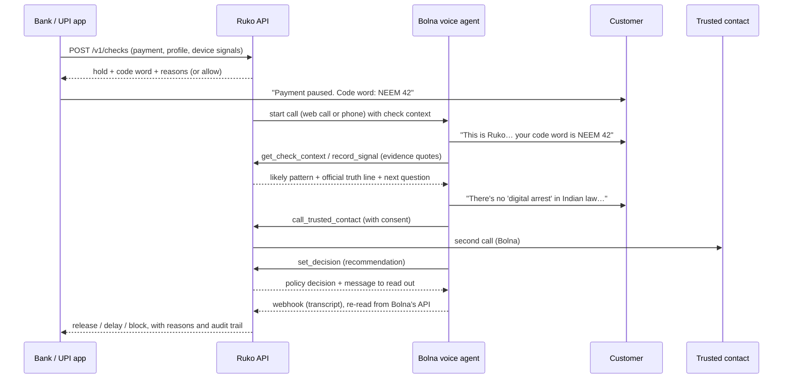

<p align="center">
  <picture>
    <source media="(prefers-color-scheme: dark)" srcset="brand/ruko-lockup-stacked-dark.svg">
    
  </picture>
</p>

<h3 align="center">A one-minute voice check that stops a payment scam before the money leaves.</h3>

<p align="center">
Built on <a href="https://www.bolna.ai">Bolna</a> for the Bolna × Y Combinator Symphony Buildathon (Oct 2026). MIT licence.
</p>

---

**Ruko** (Hindi for "wait") is an API for banks, UPI apps and NBFCs. When a payment looks coached, Ruko holds it, and within seconds a Bolna voice agent calls the customer in their language. The app shows a one-time **code word** that the agent says first, so the call is hard to spoof. The agent asks what a fraud officer would ask ("Is anyone on another call telling you what to do?"), records what it hears as evidence through tool calls, says the official truth out loud ("There's no 'digital arrest' in Indian law…"), and with consent calls the customer's trusted family contact. A deterministic, explained policy then **releases, delays or blocks** the payment. The LLM can make the outcome stricter but never more lenient, and Ruko never asks for an OTP, PIN, card or account number.

It also ships a free public **"Is this a scam?"** checker (text and voice) and a **fraud-ops console** for the bank.

| | |
|---|---|
| Landing and live demo | `/` and `/demo` (sandbox bank, recorded or live call) |
| Free public checker | `/check` |
| Fraud-ops console | `/console` (checks, transcripts with highlighted evidence, metrics, pattern library, eval, integration) |
| Bank API | `POST /v1/checks`, `GET /v1/checks/:id`, `GET /v1/metrics` |
| Docs | [Research](docs/RESEARCH.md) · [Business](docs/BUSINESS.md) · [One-page memo](docs/MEMO.md) · [Progress log](docs/PROGRESS.md) · [Bolna spend log](docs/BOLNA_SPEND.md) · [Demo script](DEMO_SCRIPT.md) · [Submission answers](docs/SUBMISSION.md) · [Citation audit](docs/CITATIONS.md) |

> **Status, honestly.** Everything below runs locally and is tested. The live Bolna path (web calls, tool calls from Bolna, webhooks) is fully wired and the three Bolna agents are created and saved unrestricted, but **no live Bolna call has been made yet**: the tool endpoints need a public URL, so live calls are tested once the app is deployed. The account has $5 of credit in total; see [docs/BOLNA_SPEND.md](docs/BOLNA_SPEND.md). Evaluation numbers are **text mode** (no audio); see [Results](#results).

## Why

- Indians reported **₹22,845.73 crore** lost to cyber fraud in 2024 ([MHA, Lok Sabha USQ 344](https://www.mha.gov.in/MHA1/Par2017/pdfs/par2025-pdfs/LS22072025/344.pdf)); "digital arrest" and related scams took **₹1,935.51 crore** across 1,23,672 incidents ([MHA, Rajya Sabha USQ 1505](https://www.mha.gov.in/MHA1/Par2017/pdfs/par2025-pdfs/RS12032025/1505.pdf)).
- Payments above ₹10,000 are about 45% of reported fraud cases but about **98.5%** of their value (NCRP data in the [RBI discussion paper, Apr 2026](https://rbi.org.in/Scripts/PublicationsView.aspx?id=23810)): the payments a bank can afford to pause for a minute.
- In these scams the victim authenticates the payment themselves, often while the scammer coaches them on another call. OTPs, SMS warnings and pop-ups don't break that. A calm voice asking the right question, in their language, before the money moves, does.

More in [docs/RESEARCH.md](docs/RESEARCH.md).

## How it works



1. **Hold.** A transparent pre-payment policy ([server/engine/policy.ts](server/engine/policy.ts)) scores the payment with named rules: active call while paying (bank's device signal), "safe account"-style payee, payee on a mule list, first payment, amount far above usual, odd hour, new digital payer, velocity, collect request or link. Every point has a plain-language reason. Some rules always hold (remote-access app, safe-account payee, mule list).
2. **Call.** The Bolna agent calls in English or Hindi (Hinglish handled by the Hindi stack), says the code word first, asks short questions, and calls Ruko's tools mid-call. The engine answers with the likely pattern and the **official** truth sentence from a cited library, so the agent never improvises official advice.
3. **Decide.** A deterministic policy ([server/engine/decision.ts](server/engine/decision.ts)) decides from the recorded signals: one critical sign delays for 24 h, a critical sign plus another strong sign blocks, explained payments release. **Safe default:** when pre-call risk is critical (a hard rule such as a "safe account" payee, the customer on a call while paying, or a very large payment to a first-time payee), a release needs positive evidence (the customer checked the payee themselves, or knows the payee personally and the purpose fits); otherwise the payment is delayed with an in-app confirm, a call-back and the fraud desk. A cover story alone never releases. The agent's recommendation can escalate but never de-escalate. A trusted contact's answer can lift a delay or escalate it. If the customer doesn't answer: retry once, then delay (never block), with an in-app prompt and fraud-desk escalation for high-risk holds.

## Built on Bolna

| Bolna feature | How Ruko uses it | Status |
|---|---|---|
| Agent API v2 | Three agents built and kept in sync by `npm run bolna:setup`: payment safety check, trusted-contact call, public safety line. All saved with `restricted: false` under Bolna's content-safety checks; `npm run bolna:check` diffs the saved agents against the repo. | in use (synced, no drift) |
| Multilingual config | English + Hindi with mid-call switching; the call starts in the customer's language via `agent_language`. | configured; first live Hindi call pending |
| Custom functions | `get_check_context`, `record_signal`, `call_trusted_contact`, `check_trusted_contact`, `set_decision` (+ `report_contact_outcome`, `lookup_pattern`, `log_report`). Prompt variables fill `check_id` and the call reference; every parameter is required because Bolna fills requests from `%(name)s` templates. | wired and tested against the engine; first live call pending |
| Web Call SDK (`@bolna/web-call`) | Browser calls in the demo, the trusted contact's "phone" and the public line. Sessions are minted server-side, single-use, behind an access code, a daily cap, a per-code cap and a wallet floor read from `GET /user/me`. | wired (deployed, gated); first live call pending |
| Webhooks | Token-protected, optional IP allowlist (Bolna's three published IPs), idempotent per execution and status; terminal events are **re-read from Bolna's API** before they can change a decision. | wired and tested; first live call pending |
| Preferred models | gpt-4.1-mini, Deepgram nova-3, Sarvam saaras:v3, ElevenLabs eleven_turbo_v2_5, Sarvam bulbul:v3: all inside Bolna's flat per-minute rate. | configured |
| Transfer to a human | Documented option for banks that need a human in the loop (UK FCA FG24/6): add Bolna's transfer tool with the bank's fraud-desk number. | documented |
| Batch calls | Documented for bank-scale back-testing of the policy against consenting staff. | documented |

Agent definitions: [server/bolna/agents.ts](server/bolna/agents.ts) · prompts: [server/bolna/prompts.ts](server/bolna/prompts.ts) · tools: [server/bolna/tools.ts](server/bolna/tools.ts) · client: [server/bolna/client.ts](server/bolna/client.ts) · webhook: [server/bolna/webhook.ts](server/bolna/webhook.ts).

## Results

Text-mode evaluation ([eval/](eval/)): an LLM plays the customer (coached victims across ten scam types at two coaching levels, genuine payers, ambiguous cases; English, Hindi, Hinglish). Ruko's agent runs with **the same prompt, greeting and tool schemas** as the Bolna agent, and the tools run against the real engine and decision policy. The agent model is a Nebius-hosted stand-in (`Qwen/Qwen3-30B-A3B-Instruct-2507`) for Bolna's gpt-4.1-mini; the customers are played by `deepseek-ai/DeepSeek-V4-Flash`; a separate judge (`openai/gpt-oss-120b`) audits every mention of OTP/PIN.

Current version (**v5**, text model `ruko-text-1.0.0`, sha256 `8a85ef11…`):

| Set | Scams caught | False holds on genuine payments | Median time to decision (est.) |
|---|---|---|---|
| **Fresh held-out set 4** (28, written and frozen before v5 ran; 16 of 18 scam calls heavily coached in Hindi/Hinglish) | **15/18** (83%) | **2/10** (both delays) | 58 s |
| Held-out set 3 (28, previously seen by v4) | 13/16 | 1/12 | 58 s |
| Held-out set 2 (28, previously seen by v3/v4) | 15/16 | 2/12 | 51 s |
| Held-out set 1 (28, previously seen) | 15/16 | 1/12 | 54 s |
| Development set (96, used for tuning) | 60/60 | 2/24 | 59 s |

- **The agent asked for an OTP, PIN, card or account number 0 times** in v5 (208 conversations, 959 agent turns; every mention judged by a separate model). Across all versions there was 1 flag in 3,487 turns: v4 asked whether a code had *already* been shared with the caller; v5 never says OTP or PIN in a question.
- **Speed:** a median of about 1 minute to a decision on every set (estimated from transcript length at speaking pace, not measured on calls); the whole call, with the goodbye and the trusted-contact offer, is about 70–80 s.
- **Hardest case:** heavily coached customers who stick to a cover story. On the fresh set 13 of 16 were caught. When pre-call risk is critical, Ruko never releases on a cover story alone (the safe default): it delays, with an in-app confirm, a call-back and the fraud desk.
- **The trade-off we chose:** v5's safe default delays a few more genuine payments than v3 did (v3: 1/48 on its held-out sets), in exchange for not releasing coached victims. Every false hold on the fresh set is a delay, not a block.
- **Version history** (every run is published, including the worse ones): v3 caught 16/16 on its clean held-out set in about 74 s; v4 cut the time to about 55 s but caught only 12/16 on its fresh set 3; v5 restores recall with adaptive probes and the safe default while keeping the call around a minute.
- **End to end**, the pre-call policy alone lets small scams with no active call through without a call (12/60 on the dev set). In production the bank's own fraud signals (FRI, mule lists) would feed it.
- Tool endpoint latency on the local dev server: p50 74 ms, p95 303 ms (`npm run latency`). Every run, transcript and miss is in [eval/results/](eval/results/) and the console's Evaluation page; each run records the text-model hash and git commit in `environment.json`.

Reproduce (uses Nebius; cached, so a re-run with the same settings is free):

```bash
npm run eval                                   # 96-scenario dev set
npm run eval -- --set holdout4                 # fresh held-out set for v5
npx tsx eval/publish.ts                        # publish to public/eval/results.json
```

The Nebius key is read at runtime from a `.env` outside this repo (`server/env.ts`) and is never logged.

## Run it locally

Requirements: Node 20+ (tested on 22), npm. Chrome or Edge for the e2e and screenshot scripts.

```bash
npm install
cp .env.example .env          # add BOLNA_API_KEY to use live calls (optional)
npm run dev                   # http://localhost:5410 (app + API on one server)
```

Without a Bolna key everything works except live calls: the sandbox shows the recorded run, which replays a text-mode conversation's tool calls into the live engine.

```bash
npm run check                 # type-check, lint, unit tests (105), text-model tests (73), secret scan
npm run build && npx tsx scripts/serve-prod.ts 5430   # production build, served like Vercel
node scripts/e2e.mjs http://localhost:5430            # every scenario + a full recorded run
node scripts/screenshots.mjs http://localhost:5430    # docs/screenshots at 1440 and 375
npm run brand                 # regenerate logo SVGs, icons and the OG card
```

## Deploy (Vercel Hobby)

The app is one Vite build plus one serverless function ([api/router.ts](api/router.ts)) in the `bom1` (Mumbai) region; state lives in the Vercel Runtime Cache, with an optional private Vercel Blob archive for decided checks.

```bash
npx vercel@latest              # link and deploy a preview
npx vercel@latest --prod
```

Environment variables (Project → Settings → Environment Variables):

| Variable | Needed for |
|---|---|
| `BOLNA_API_KEY` | live calls (server only; never sent to the browser) |
| `BOLNA_CHECK_AGENT_ID`, `BOLNA_CONTACT_AGENT_ID`, `BOLNA_LINE_AGENT_ID` | written to `.env` by `npm run bolna:setup` |
| `RUKO_TOOL_TOKEN`, `RUKO_WEBHOOK_TOKEN` | secrets Bolna presents to Ruko (generated by `bolna:setup`) |
| `RUKO_PUBLIC_BASE_URL` | the deployed https URL |
| `RUKO_API_KEYS` | bank API keys, `tenant:key` pairs |
| `RUKO_ACCESS_CODES` | access codes for live calls (give to judges); without them, live calls are off |
| `RUKO_DAILY_CALL_CAP`, `RUKO_PER_VISITOR_DAILY_CAP`, `RUKO_WALLET_FLOOR_CENTS` | the credit-budget gate |
| `NEBIUS_API_KEY` | local evaluation only (read from a `.env` outside the repo); never set on a deployment, which never calls an LLM for the public checker |
| `BLOB_READ_WRITE_TOKEN` | optional durable audit archive |

After the first deploy, point the Bolna agents' tools and webhook at it (free; no call placed):

```bash
npm run bolna:setup -- https://<your-deployment>.vercel.app
```

## API

```bash
curl -X POST https://<ruko>/v1/checks \
  -H "Authorization: Bearer rk_test_..." -H "Idempotency-Key: pay-7781" \
  -H "Content-Type: application/json" \
  -d '{"payment":{"amount_inr":190000,"rail":"IMPS","payee":{"name":"Safe Custody Account RBI","handle":"XXXXXXXX4417","is_new":true}},
       "customer":{"customer_ref":"c-001","name":"Kamla","language":"hi","max_amount_90d":12000,"avg_amount_90d":3200,"digital_tenure_days":210,
                   "trusted_contact":{"name":"Ravi","relation":"son","phone_e164":"+447700900102","consent_on_file":true}},
       "device":{"active_call":true,"active_call_minutes":47,"caller_in_contacts":false}}'
```

Returns `action: "hold"`, the code word, every risk reason with its weight, and a `client_secret` the customer's app uses for `GET /v1/checks/:id/app-status` and `POST /v1/checks/:id/web-session`. Retries with the same `Idempotency-Key` return the same check; the same key with a different body is a 409. Full contract on the console's Integration page.

## Security and privacy

- **No secrets in the browser.** Web-call sessions are minted server-side; the Bolna key never leaves the server.
- **Bolna → Ruko** tool calls carry a bearer token (constant-time compared) and can be restricted to Bolna's published IPs; webhooks need a secret URL token and are verified by fetching the execution back from Bolna.
- **Never asks for secrets.** The prompts forbid OTP/PIN/card/account requests; evidence quotes are scrubbed of digit runs before they enter the audit log; the eval audits every agent turn.
- **Public checker:** official-advisory library + on-server text classifier; no LLM, and nothing the person types is stored. Phone numbers, UPI IDs, e-mails, links and long digit runs are redacted on the server before the classifier runs; only anonymous counters are kept (production traffic only, small groups folded).
- **Disclosure:** every agent's greeting says it is automated and that the call is recorded (our policy, and the DPDP notice). Separately, TRAI PR 119/2026 requires banks to pre-declare automated calls and their caller IDs to the operator. The trusted contact is only called after a warning sign and the customer's consent (data minimisation).
- **No real personal data:** demo people and payees are invented; phone numbers use the UK Ofcom drama range (+44 7700 900xxx), since India has no reserved fictional range.
- `npm run scan:secrets` checks every file git would commit for key patterns and for the literal values in local env files.

## Honest limits

- **No live call measured yet.** The voice path is wired end to end but untested on Bolna until deployment; the eval is text mode with a stand-in LLM and estimated call times.
- **Voice languages:** English and Hindi (with Hinglish). Tamil, Bengali and Marathi truth lines in the library are drafts awaiting native review.
- **Phone calls are switched off** (`RUKO_ALLOW_PHONE_CALLS=false`) to protect the $5 budget; in the demo the trusted contact's call rings in a browser tab instead.
- **The pre-call policy's weights are hand-set**, not learned; a bank would tune them on its own data and feed in its own signals (FRI, mule lists, device telemetry). The device signals in the sandbox are simulated.
- **State** lives in the Vercel Runtime Cache (ephemeral by design); durable storage is the optional Blob archive. A bank deployment would use its own database.
- **The console's demo bank** is populated with eval conversations replayed through the real engine (synthetic customers, tagged "eval replay").
- **Content safety:** Bolna restricts agents for "scam or fraud-related behavior". The agents are framed as a bank's payment safety check and are saved unrestricted today; that could change if Bolna's checks change.
- **Not legal advice.** Regulatory notes in [docs/BUSINESS.md](docs/BUSINESS.md) are our reading of public documents.

## Repository map

```
api/router.ts          the one Vercel function (all /v1 and /api routes)
server/                engine (policy, decision, checks, tools), Bolna client/agents/prompts/webhook, stores, public checker
shared/                types, signal taxonomy, pattern library and sources, demo scenarios
src/                   React app: landing, demo, public checker, console, brand components; src/kit is the house design kit
eval/                  text-mode eval harness, scenarios, held-out sets, results, replays, publish
scripts/               bolna-setup, brand, e2e, screenshots, latency, serve-prod, secret-scan
brand/                 logo SVGs (light, dark, mono), lockups, app icon, OG card
docs/                  research, business, memo, progress, spend log, screenshots
research/, data/patterns/, ml/, server/ml/   extended pattern library and text classifier (separate workstream)
```

## Credits

- **Logo concept by Yashvardhan Thanvi**, redrawn as vectors in [brand/](brand/).
- Fonts: Open Runde, Inter, Instrument Serif, Fragment Mono, Silkscreen (all SIL Open Font License, self-hosted via Fontsource).
- Icons: Lucide (ISC).
- Scam-pattern facts and wording come from public advisories by MHA/I4C, RBI, CERT-In, DoT, TRAI, SEBI and NPCI; each pattern cites its sources ([shared/sources.ts](shared/sources.ts)).
- Voice by [Bolna](https://www.bolna.ai). Evaluation LLMs via Nebius Token Factory.

Ruko is not affiliated with Bolna, RBI, NPCI, I4C or any bank. Demo Bank is fictional.

MIT © 2026 Yashvardhan Thanvi
